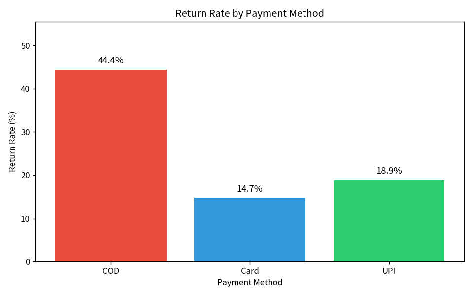
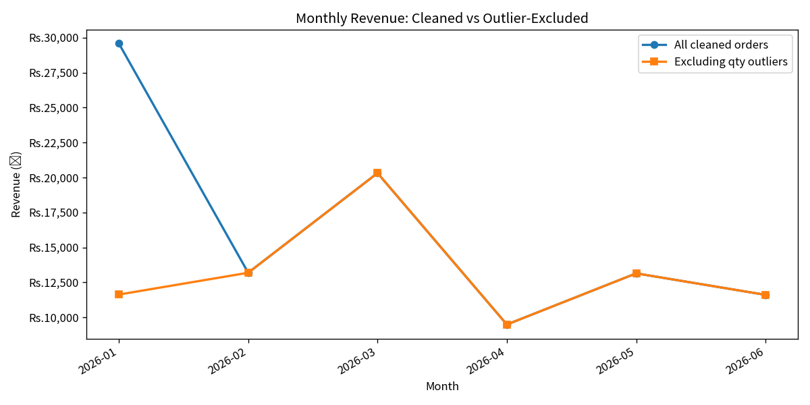

# 🌱 Mamaearth Returns & Growth Intelligence Pipeline

> **A reproducible data analytics capstone project** that transforms raw e-commerce data into business insights through SQL reporting, Python data cleaning, statistical testing, financial reconciliation, visualizations, and AI-generated business narratives.

---

## 📑 Table of Contents

1. [Project Overview](#-project-overview)
2. [Business Objectives](#business-objectives)
3. [Repository Structure](#-repository-structure)
4. [Technology Stack](#️-technology-stack)
5. [Dataset](#-dataset)
6. [How to Run](#-how-to-run)
7. [Analytical Approach](#-analytical-approach)
8. [Key Financial Findings](#-key-financial-findings)
9. [Visualizations](#-visualizations)
10. [GenAI Business Narrator](#-genai-business-narrator)
11. [Limitations](#️-limitations)
12. [Project Information](#-project-information)

---

## 📌 Project Overview

E-commerce businesses face challenges related to product returns, payment preferences, revenue accuracy, and data quality.

This project investigates these challenges using a complete analytical workflow:

**SQL → Data → Cleaning & EDA → Visualizations → Business Narrative**

### Business Objectives

- **Revenue Accuracy:** Reconcile SQL and Python revenue after duplicate removal.
- **Return Analysis:** Test whether Cash-on-Delivery (COD) orders have a higher return rate.
- **Customer Segmentation:** Identify high-risk payment method and city-tier combinations.
- **Trend Analysis:** Evaluate how quantity outliers affect monthly revenue trends.
- **Automated Reporting:** Generate evidence-based business narratives using Gemini or an offline fallback.

---

## 📂 Repository Structure

```text
mamaearth-repo/
├── README.md
├── requirements.txt
├── sql/
│   ├── schema.sql
│   ├── seed_data.py
│   └── reports.sql
├── data/
│   ├── customers.csv
│   ├── products.csv
│   └── orders.csv
├── analysis/
│   ├── clean_and_eda.py
│   └── visualize.py
├── visualizations/
│   ├── return_rate_by_payment.png
│   └── monthly_revenue_comparison.png
└── narrator/
    ├── findings.json
    ├── generate_narrative.py
    └── sample_output.txt
```

---

## 🛠️ Technology Stack

| Component | Tools |
|---|---|
| Database | SQLite |
| Data Processing | Python, pandas, NumPy |
| Statistical Testing | SciPy |
| Visualization | Matplotlib |
| AI Narrative | Google Gemini API, offline fallback |
| Environment | Python 3.10+ |

---

## 📊 Dataset

The project uses three CSV files containing **180 raw orders**, 45 customers, and 16 products.

| File | Records | Purpose |
|---|---:|---|
| `customers.csv` | 45 | Customer details and city tiers |
| `products.csv` | 16 | Product names, categories, and prices |
| `orders.csv` | 180 | Transactions, quantities, discounts, payments, ratings, and returns |

**Data relationships:** Orders link to customers and products through their respective IDs.

---

## 🚀 How to Run

### 1. Install dependencies

```bash
python -m venv .venv
```

Activate the environment:

```bash
# Windows
.venv\Scripts\activate

# macOS / Linux
source .venv/bin/activate
```

Install packages:

```bash
pip install -r requirements.txt
```

### 2. Run the SQL layer

```bash
python sql/seed_data.py
```

Execute the nine business reports using your report runner, if included in the repository.

### 3. Run Python analysis

```bash
python analysis/clean_and_eda.py
python analysis/visualize.py
```

### 4. Generate the business narrative

```bash
python narrator/generate_narrative.py
```

**GenAI is optional:** Configure a Gemini API key if required by your implementation. Without it, the narrative generator uses the offline fallback.

---

## 🔍 Analytical Approach

| Analysis | Method |
|---|---|
| Data quality | Missing-value inspection, standardization, deduplication, and imputation |
| Revenue calculation | Quantity × price × discounted selling price |
| COD return hypothesis | One-sided two-proportion z-test |
| Segment risk | Return-rate analysis by payment method and city tier |
| Quantity outliers | Interquartile range (IQR) flagging |
| Monthly trends | Comparison of cleaned revenue with outlier-excluded revenue |
| Financial validation | SQL versus Python revenue reconciliation |

**Important:** Quantity outliers are flagged for analysis, not automatically deleted.

---

## 💰 Key Financial Findings

| Metric | Result |
|---|---:|
| Raw orders | 180 |
| Orders retained after deduplication | 175 |
| Duplicate rows removed | 5 |
| SQL discounted revenue | ₹99,860.20 |
| Cleaned Python revenue | ₹97,358.30 |
| Revenue difference | ₹2,501.90 |
| Average order value (SQL) | ₹554.78 |

**Revenue reconciliation:** The ₹2,501.90 difference is attributed to the five duplicate rows removed during cleaning. Returned orders remain included in both revenue calculations.

---

## 📈 Visualizations

### 1. Return Rate by Payment Method



Compares return rates across UPI, Card, and COD payment methods.

### 2. Monthly Revenue Comparison



Compares monthly revenue before and after excluding flagged quantity outliers.

---

## 🤖 GenAI Business Narrator

The narrator converts structured analytical findings into a concise business-oriented explanation.

- **`findings.json`** — structured findings generated from the analysis.
- **`generate_narrative.py`** — produces the narrative using Gemini or a deterministic offline template.
- **`sample_output.txt`** — example narrative output.

The narrative should be based on calculated findings rather than unsupported assumptions.

---

## ⚠️ Limitations

- The dataset is **synthetic and intended for educational use**.
- Some customer segments may have small sample sizes.
- Return reasons and product-quality information are unavailable.
- Statistical findings should not automatically be generalized to real-world business operations.

**Future enhancements:** Customer lifetime value (LTV), return-reason analysis, and COD pre-authorization experiments.

---

## 📁 Project Information

**Developer:** Naman Jain  
**Program:** Data Analytics with AI & GenAI  
**Institution:** E&ICT Academy, IIT Roorkee

**Disclaimer:** This is an independent educational project. It is not affiliated with Mamaearth and does not represent the company's official or audited financial results.

**License:** Free for educational and portfolio use, subject to applicable data and dependency licenses.
